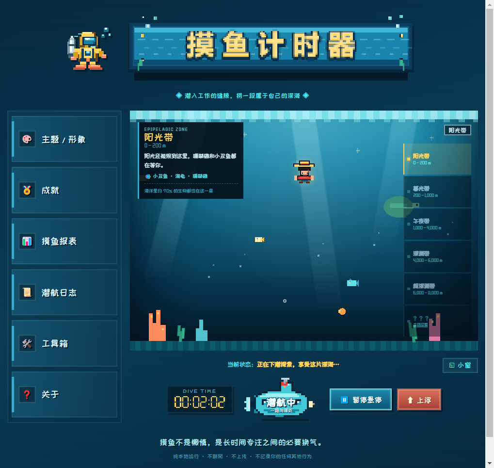
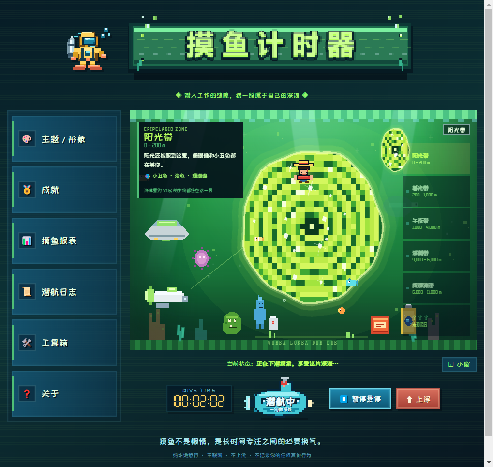
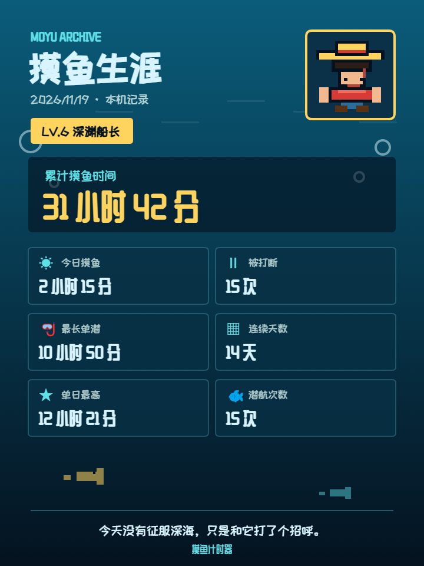

# 🐟 摸鱼计时器 · Moyu Timer

> 把「摸鱼」变成一场深海潜航。一个不联网、不上传、只属于你自己的桌面小组件。
> 
## 📸 


| 瑞克和莫蒂主题 | 桌面小窗 | 摸鱼生涯分享图 |
|---|---|---|
|  |  |  |


## 🚀 下载
1. 打开本仓库的👉 [Releases](https://github.com/TTonyChopper233/moyu-timer/releases) 👈页面，下载 `Mfish.exe`。
2. 双击运行，**不需要安装，也不需要装 Node.js 或 Electron**。
3. 小窗会出现在屏幕右下角。托盘图标右键可以：显示小窗 / 展开完整版 / 退出。
4. 首次运行时 Windows 可能提示「未知发布者」——这是没有购买代码签名的正常现象，选择 **更多信息 → 仍要运行** 即可。
---


## ✨

| | |
|---|---|
| 🌊 **三态潜航** | 下潜 / 悬停 / 上浮，暂停不计入时长，随时接得上 |
| 🗺️ **6 层海洋分带** | 参考真实海洋学：阳光带 → 暮光带 → 午夜带 → 深渊带 → 超深渊带 → **隐藏彩蛋层** |
| 🐠 **24 种像素鱼** | 每层都有专属鱼群与场景装饰，越深越神秘 |
| 🏅 **60 个成就** | 海贼王、瑞克和莫蒂、柯南、柴犬等动漫游戏梗，解锁后还有一句风味小字 |
| 🎨 **4 套主题** | 深海潜航 / 阳光沙滩 / 比奇堡 / 瑞克和莫蒂，连标题招牌和小窗都会一起换 |
| 🧑‍🚀 **14 个像素形象** | 路飞、索隆、娜美、乔巴、潜水 Cheems、章鱼哥、瑞克、莫蒂……按累计时长解锁 |
| 📊 **可分享的摸鱼档案** | 720×960 战绩图 + 一键复制文案，随机标语，主题与角色自动同步 |
| 🪟 **桌面悬浮小窗** | 240×180，常驻屏幕右下角，无边框、不占任务栏，像个小桌面宠物 |

### 小彩蛋

单次连续摸鱼满 **10 小时**，会抵达第 6 层——「克苏鲁遗迹」。在那里，连主题地图都会让位给沉睡的古城。

---


## 🎮 怎么玩

- **下潜**：点黄色像素潜艇（完整版）或小窗的 🤿 按钮开始计时。
- **悬停**：需要干活时点「暂停悬停」，这段时间**不会**计入摸鱼。
- **上浮**：结束这一潜，弹出本次时长和可能解锁的成就。
- **航海档案**（完整版左侧栏）：主题 / 形象、成就、摸鱼报表、潜航日志、工具箱、关于。
- **摸鱼报表**：累计时长、今日时长、被打断次数、最长单潜、连续天数、单日最高、潜航次数、当前段位——一键生成分享图。

---

## 📁 项目结构

```
.
├── index.html          # 全部界面、样式与游戏逻辑（单文件前端）
├── main.js             # Electron 主进程：窗口、托盘、IPC、单实例锁
├── preload.js          # contextBridge 安全桥接
├── gen_icon.js         # 图标生成脚本（PNG + 多尺寸 ICO）
├── tray.png            # 托盘 / 窗口图标
├── build/              # 打包资源（icon.ico、icon.png）
├── dist/               # 打包产物（不进版本库）
├── 启动摸鱼小窗.bat     # 开发期 Windows 启动脚本
└── package.json        # 依赖与打包配置
```

## 🛠 技术栈

- **Electron 33** + 原生 HTML / CSS / JavaScript（无前端框架、无构建步骤）
- **localStorage** 做本地持久化，跨窗口通过 IPC + storage 事件 + 轮询三重同步
- **Canvas / SVG** 手绘全部像素素材：标题招牌、潜艇按钮、鱼群、角色、传送门、分享图——**没有引用任何外部图片**
- **electron-builder** 打成 NSIS portable 单文件

## 🔒 隐私

纯本地运行。不联网、不上传、不记录任何其他行为。数据只存在你的电脑里（`%APPDATA%\moyu-timer`），随时可以在工具箱里导出或清空。


## 📄 许可

MIT License. 玩得开心，摸得优雅  
  希望给大家无聊的工作时间带来一点乐趣~
  本项目为个人非商业作品；第三方角色及相关权利归原权利人所有，许可证仅适用于本项目原创代码。
