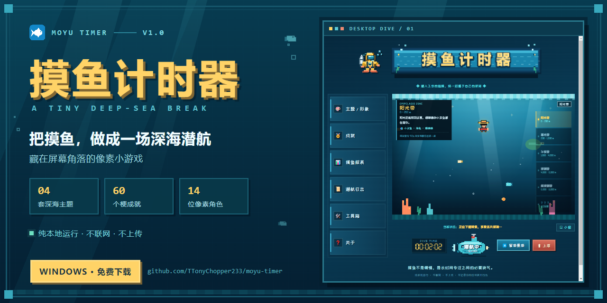
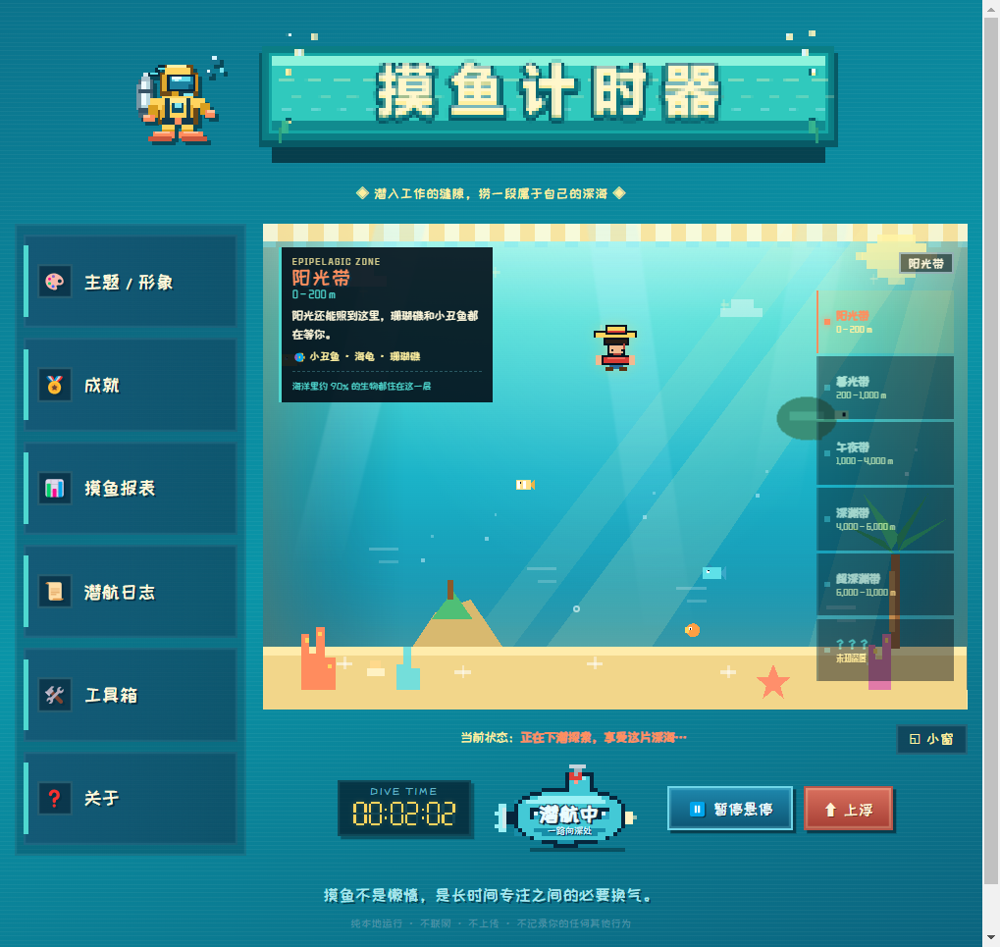
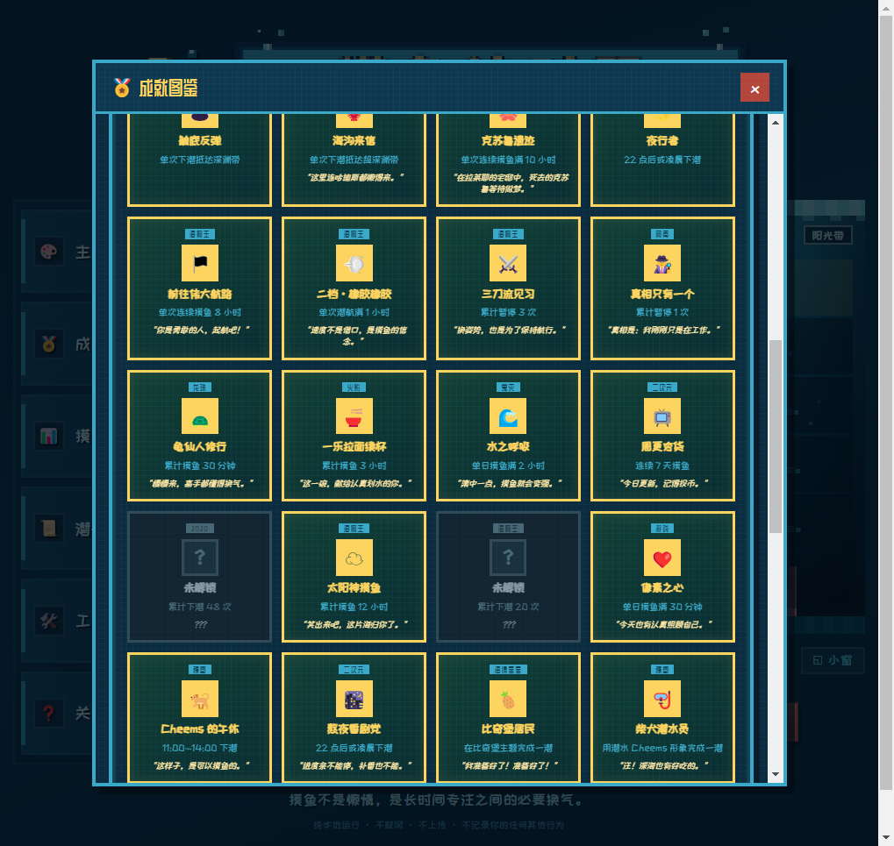
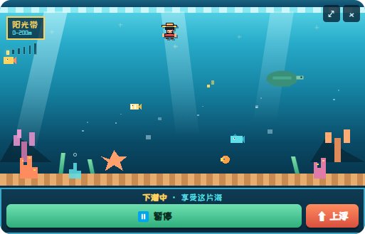

# 摸鱼计时器 · Moyu Timer

> 工作累了，就潜下去待一会儿。

<p align="center">
  <a href="https://github.com/TTonyChopper233/moyu-timer/releases/latest"><strong>下载 Windows 版</strong></a>
  ·
  <a href="docs/DEVLOG.md">看看开发手记</a>
  ·
  <a href="#自己跑起来">本地运行</a>
</p>

<p align="center">
  
  
  
  <a href="LICENSE"></a>
</p>

<p align="center">
  
</p>

这不是一个劝你自律的工具。

它更像藏在屏幕右下角的一小片海：想喘口气时，点一下「下潜」，潜水员开始往下沉，鱼群慢慢出现；有人经过就「悬停」，回来再继续。暂停的时间不算进摸鱼时长——毕竟，被工作打断的摸鱼，怎么能算摸鱼呢？

它会认真记下这些碎片时间，但不想把休息变成另一张工时表。**统计是副产品，快乐才是主菜。**

## 这片海里有什么

**一次摸鱼，就是一次下潜。** 下潜、悬停、继续、上浮，随时接得上。小窗不显示不断跳动的精确秒数，也不用精确深度提醒你究竟摸了多久。

**越往深处，画风越不对劲。** 从阳光带一路经过暮光带、午夜带、深渊带和超深渊带，24 种像素鱼会随着海域出现。单次连续下潜满 10 小时，还有一处不太科学的遗迹等着你。

**摸着摸着，就收集了一柜子东西。** 4 套主题、60 个梗成就、14 位像素角色。有些奖励来自时长，有些来自你可能也没注意到的摸鱼习惯。

**想留个纪念，就生成一张「摸鱼生涯」。** 今日时长、最长一潜、连续天数和当前段位都会装进一张主题一致的分享图。文案不叫战报，因为战报有股班味。

## 看一眼就好，不用翻太久

<table>
  <tr>
    <td align="center" width="33.33%">
      
      <br><b>不想深海，就去晒太阳</b>
    </td>
    <td align="center" width="33.33%">
      
      <br><b>换个宇宙继续摸</b>
    </td>
    <td align="center" width="33.33%">
      
      <br><b>总有些成就来得莫名其妙</b>
    </td>
  </tr>
</table>

<details>
  <summary>再看看它缩在桌面角落的样子</summary>
  <p align="center">
    
  </p>
  <p align="center">240×180，无边框，常驻右下角。像桌面宠物，只是它刚好还会计时。</p>
</details>

更多主题、角色、报表与隐藏层截图，都放在 [docs/screenshots](docs/screenshots/) 里。

## 下载即用

目前提供 **Windows x64 便携版**，不需要安装，也不需要另外安装 Node.js 或 Electron。

1. 打开 [最新 Release](https://github.com/TTonyChopper233/moyu-timer/releases/latest)，下载页面中的 `.exe` 文件。
2. 双击运行，小窗会出现在屏幕右下角。
3. 右键托盘图标，可以显示小窗、展开完整版或退出。
4. 想换片海域，就在完整版的「航海档案」里更换主题和角色。

> 首次运行时，Windows 可能提示「未知发布者」。这是个人项目没有购买代码签名证书的正常现象；确认文件来自本仓库后，可选择「更多信息 → 仍要运行」。

## 自己跑起来

想改代码，或者先试试开发版：

```bash
npm install
npm start
```

重新打包 Windows 便携版：

```bash
npm run dist
```

也可以直接用浏览器打开 `index.html` 体验完整版。浏览器与桌面端的数据彼此独立，可以通过应用内的导入、导出功能搬运。

## 数据在哪里

不联网，不上传，不需要账号，也不记录其他行为。计时、成就和设置只保存在你的电脑里，桌面端数据位于 `%APPDATA%\moyu-timer`，随时可以导出或清空。

## 项目结构

```text
.
├── index.html                 # 界面、像素绘制与全部交互逻辑
├── main.js                    # Electron 窗口、托盘、IPC 与单实例锁
├── preload.js                 # contextBridge 安全桥接
├── tray.png                   # 托盘与窗口图标
├── build/                     # 打包图标资源
├── docs/
│   ├── DEVLOG.md              # 从计时表长成小海洋的开发记录
│   ├── screenshots/           # 应用真实截图
│   └── social/                # 推广图与 GitHub 分享封面
├── scripts/                   # 图标与封面生成脚本
├── 启动摸鱼小窗.bat            # Windows 开发启动脚本
└── package.json               # 依赖、运行与打包配置
```

技术上没有什么庞大框架：Electron 33、原生 HTML/CSS/JavaScript、SVG/Canvas 和 localStorage。像素角色、鱼群、场景和分享图都由代码绘制，离线也能完整运行。

## 最后

这个项目从一张很正经的计时表开始，后来越改越像一个小玩具。中间踩过的坑、重画三次的传送门，以及为什么坚持「暂停不算摸鱼」，都写在了 [开发手记](docs/DEVLOG.md) 里。

本项目以 [MIT License](LICENSE) 发布。许可证仅适用于项目原创代码；涉及的第三方角色与相关权利归原权利人所有，请将它当作一份非商业的像素二创小作品。

如果它让你在某个下午三点笑了一下，欢迎留个 Star；有新点子，也欢迎来 Issue 里聊聊。祝你摸得轻松，也别忘了上浮。
